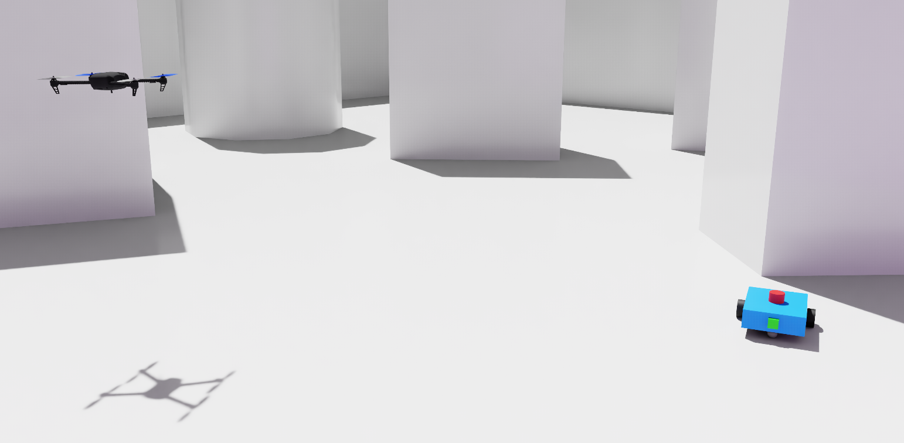
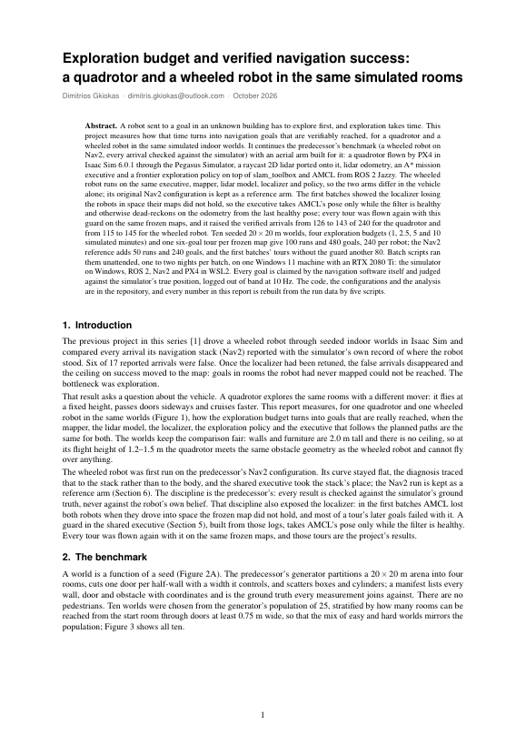
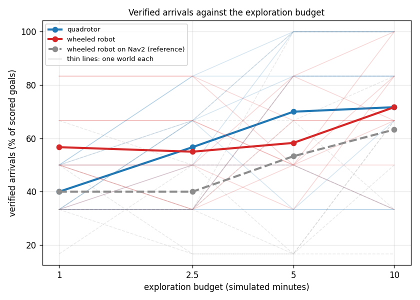
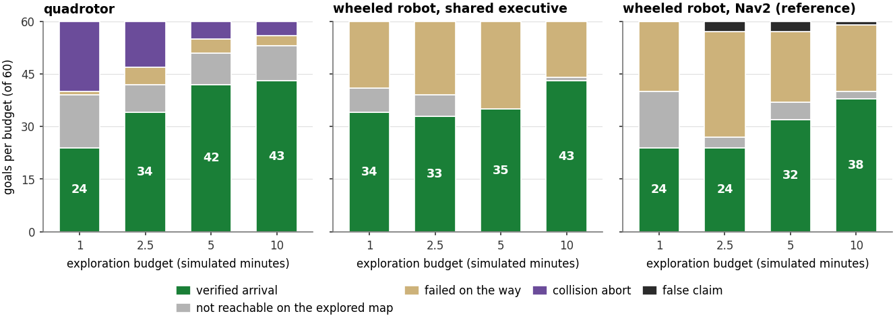
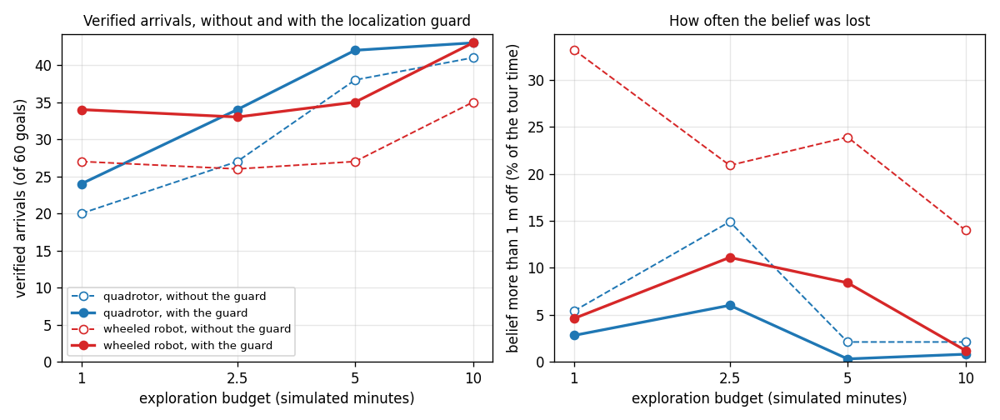
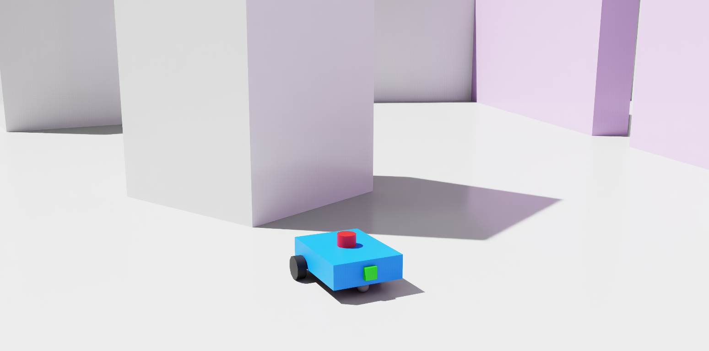
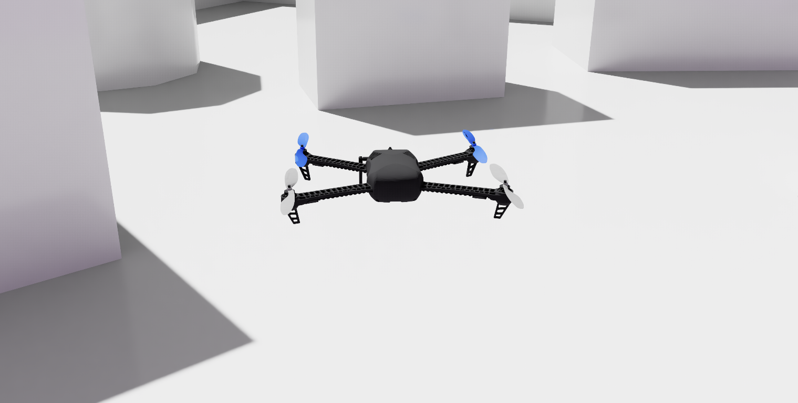
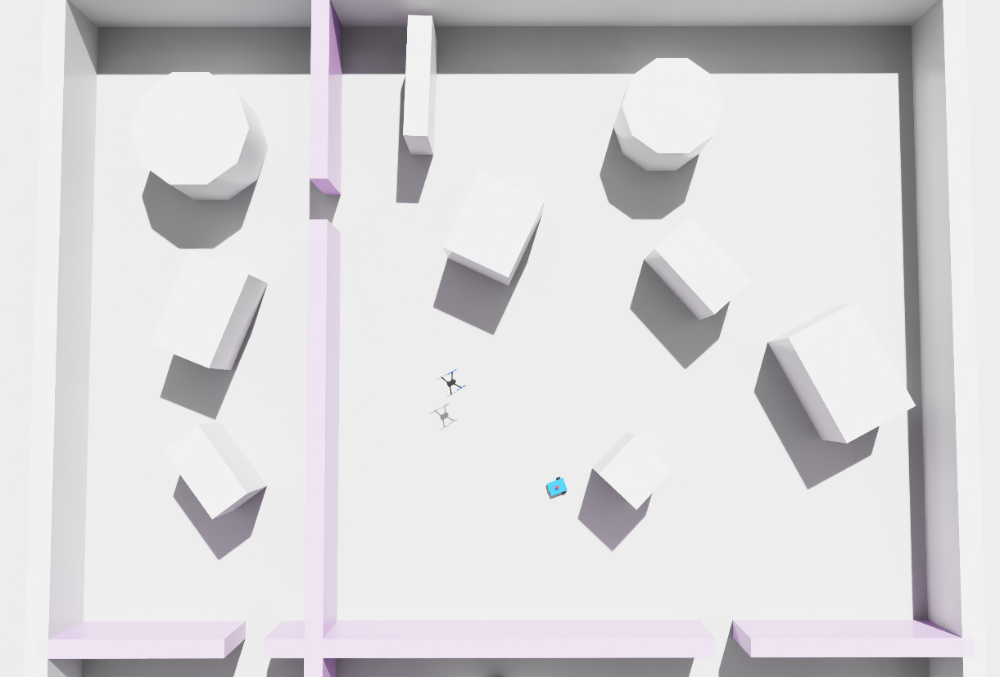

# aerial-explore-bench

A simulation benchmark that measures how the time a robot spends exploring an unknown building turns into navigation goals it verifiably reaches, for a quadrotor and a wheeled robot in the same seeded indoor worlds. Both robots share the mapper, the simulated lidar, the localizer, the exploration policy and the mission executive that follows the planned paths; what differs is the vehicle. The same wheeled robot on Nav2, with the predecessor's revised configuration, is kept as a reference arm. Every claimed arrival is judged against the simulator's own record of where the robot was.



Ten seeded 20 × 20 m worlds, four exploration budgets (1, 2.5, 5 and 10 simulated minutes), one six-goal tour on each frozen map: 480 goals, 240 per robot, and another 240 for the Nav2 reference, run unattended by batch scripts on one Windows 11 machine with an RTX 2080 Ti (Isaac Sim 6.0.1 on Windows, Nav2 and PX4 in WSL2). The report is attached to the [release](https://github.com/d1mitrios/aerial-explore-bench/releases).

| Verified arrivals, of 60 goals per budget | 1 min | 2.5 min | 5 min | 10 min | All | False claims |
|---|---|---|---|---|---|---|
| Quadrotor, shared executive | 24 | 34 | 42 | 43 | 143 of 240 | 0 |
| Wheeled robot, shared executive | 34 | 33 | 35 | 43 | 145 of 240 | 0 |
| Wheeled robot, Nav2 (reference) | 24 | 24 | 32 | 38 | 118 of 240 | 7 |

The budget is the simulated time the robot explored before its map was frozen; an arrival is verified when the simulator's true position lies within 1.5 m of the goal at the moment the robot claims it.

## Report and video

<p align="center">
  <a href="https://github.com/d1mitrios/aerial-explore-bench/releases/download/v1.0.0/report.pdf"></a>
</p>

The report ([PDF, 9 pages](https://github.com/d1mitrios/aerial-explore-bench/releases/download/v1.0.0/report.pdf)) describes the benchmark, the two robots and every result below. The video is a short demonstration of both robots in the benchmark's worlds:

https://github.com/user-attachments/assets/ca295700-faa1-41f4-9e3a-66605798c51c

## What came out

| | |
|---|---|
|  |  |

The quadrotor's verified arrivals rose with the budget from 40 % of its goals at 1 min to 72 % at 10 min (24, 34, 42 and 43 of 60), and its map coverage from 169 to 245 m². The wheeled robot on the same executive reached 57, 55, 58 and 72 % (34, 33, 35 and 43 of 60) while its coverage grew from 136 to 246 m²: ten goals ahead of the quadrotor at 1 min, one behind at 2.5 min, seven behind at 5 min and even at 10 min, 145 against 143 over the four budgets; across the ten worlds only the 1 min difference is clear (the wheeled robot ahead in seven worlds, behind in none). Neither robot made a false claim, in 143 and 145 claims. The wheeled robot's remaining failures are goals in space the frozen map does not contain, doors of 0.75 to 0.80 m where the lidar safety hold stops it, doors the slam map draws too narrow for its 0.30 m planner radius, and contact with geometry its map does contain: 63 of its 102 contact episodes, 58 of them with the localizer right and 43 of those at door frames, with 5 cm between its 0.30 m planner radius and the 0.25 m its corners and wheels reach. The quadrotor's impacts fall from 49 to 11 with the budget because 98 of its 119 struck geometry its map did not yet contain (`analysis/collision_sources.py`).



The project started with the executive following AMCL's pose at every moment. In those first batches AMCL lost the robots almost only where they drove into space the frozen map did not hold, a tour rarely recovered from a loss (60 of the 67 goals that followed one failed), and the verified arrivals were 126 for the quadrotor and 115 for the wheeled robot. AMCL's covariance rose in all 22 wheeled tours in which its pose went more than 1 m off and in 11 of the 12 such quadrotor tours, in most of them before the error did, so the localization guard (`--loc-guard`, on by default, `missions/README.md`) takes AMCL's pose only while the filter is healthy, dead-reckons on the lidar odometry from the last healthy pose otherwise, reseeds AMCL with that pose once it is back in mapped space, and returns to AMCL when the two agree. Every tour was then flown again with the guard on the same frozen maps, and those tours are the results above: the quadrotor's verified arrivals rose from 126 to 143 (10 tours better, none worse, sign test p = 0.002) and the wheeled robot's from 115 to 145 (22 better, 2 worse, p < 0.001), and the share of tour time with the belief more than 1 m off fell from 6.5 to 2.4 % and from 22.5 to 6.1 %. Without the guard the quadrotor led by eleven goals; with it the totals are 143 and 145. The guard's thresholds come from the logs of the tours it was then judged on, so these gains are measured in sample (`analysis/loc_guard_compare.py`, the report's Section 5).

On Nav2, the reference arm, the same wheeled robot runs the predecessor's revised configuration (`policies/nav2/nav2_params.yaml`) and reaches 40, 40, 53 and 63 % (24, 24, 32 and 38 of 60), its coverage growing from 143 to 264 m². The wheeled robot started on the predecessor's first configuration (in its v8 form, `policies/nav2/nav2_params_v8.yaml`), whose curve stayed flat at 20, 20, 20 and 18 verified arrivals (of 60, 60, 58 and 57 scored goals): its planner found no path through the slam map's doors, its controller commanded turns too slow for the drive, and its collision monitor froze the robot at walls it was clear of, so the robot moved onto the shared executive. The revised configuration answers those faults and its curve rises with the budget, but it trails the executive at every budget, by 10, 9, 3 and 5 goals, and 7 of its 125 claims were false: each came after AMCL had lost the robot, 3 to 18 m from the truth, and Nav2 reported the goal reached where it believed the robot to be. AMCL lost the robot in 23 of its 40 tours, 22 times off the known-free cells of the frozen map; per metre driven there it lost it as often as the first configuration did, 1.9 times per 100 m (a rough comparison: the first configuration lost AMCL only five times), but it drove there more than four times as far, now that it passes the doors and no longer freezes. Nothing on Nav2 plays the guard's part (`analysis/nav2_localization.py`, the report's Section 6).

## The two robots

| The wheeled robot | The quadrotor |
|---|---|
|  |  |
| The predecessor's differential-drive robot, a 0.40 × 0.30 m body, driven by the quadrotor's mission executive through a point controller on the velocity command, with lidar odometry (rf2o) and a 0.30 m planner radius. The reference arm runs it on Nav2 with the predecessor's revised configuration (NavFn, DWB, AMCL, wheel odometry with injected noise) and one correction for this setup, documented in the file. | The Iris of the Pegasus Simulator flown by PX4 SITL at 1.2 to 1.5 m, with a raycast 2D lidar ported onto it, lidar odometry (rf2o) and a small mission executive: A* on the frozen map, pure pursuit, doors passed sideways, an impact detector on the inertial sensor. |

The worlds are the predecessor's: a cross partition into four rooms, one door per half-wall of a controlled width, seeded boxes and cylinders, walls and furniture 2.0 m tall and no ceiling, so the quadrotor meets the same obstacles as the wheeled robot and the same 2D map serves both. A manifest per world lists every wall, door and obstacle with coordinates and is the ground truth every measurement joins against.



## How a run works

The robot explores once, on a clock that counts simulated time, with the frontier policy: pick the nearest frontier by path length, drive there, repeat; the map is frozen at 1, 2.5, 5 and 10 minutes while the run continues. Each frozen map then gets one tour of the world's goals in file order, scored on the first six (the first aerial batch flew all ten, and the first six goals of a longer tour are exactly the six-goal tour), 240 s and one retry per goal, with AMCL localizing on that map and the executive taking its pose only while the filter is healthy (the localization guard). The stack claims each arrival by itself (Nav2's success signal, or the executive's own estimate within 0.35 m of the goal); the simulator writes the true position to a file at 10 Hz, out of band, and the analysis joins every claim with it: within 1.5 m of the goal is a real arrival, beyond it a false one, and a claim whose own estimate was more than 1.5 m off is void. Every goal also gets one outcome class from the logs (`analysis/goal_outcomes.py`), and the wheeled robot's contact with the geometry is read from the ground truth. The analysis reads the quadrotor from `runs/raw/batch_lg`, the wheeled robot on the executive from `runs/raw/wbatch_lg`, the first batches' tours, without the guard, from `runs/raw/batch` and `runs/raw/wbatch3` (which also hold the explorations) and the Nav2 reference from `runs/raw/wbatch_nav2rev` (its first configuration from `runs/raw/wbatch2`).

## Layout

| Path | Contents |
|---|---|
| `worlds/` | The ten worlds: manifests (the ground truth) and maps, the world list with door widths and reachable rooms |
| `sim/` | The Isaac side: the quadrotor flight app with the raycast lidar and the ground-truth logger, the wheeled robot's stage and bootstrap, the launchers, the photo scene |
| `policies/` | The configurations the arms run on: Nav2 (the reference arm's revised configuration, the first configuration and its outline variant), AMCL, slam_toolbox, rf2o, and OpenVINS for the optional VIO odometry |
| `missions/` | The frontier policy, the goal sets, the two robots' exploration and mission runners, the bring-up scripts, the batch runners, the offline mock harnesses |
| `analysis/` | The verdicts and every table and figure, all from the ground truth; `analysis/results/` holds the benchmark's tables |
| `docs/` | `INSTALL_PEGASUS.md`, the quadrotor's simulator setup (Pegasus on Isaac Sim 6.0.1, PX4, OpenVINS), and `images/`, screenshots of the two robots, of a world and of the report |
| `VERSIONS.md` | The pinned stack, with the build notes that made it work on this machine |

`worlds/`, `sim/`, `policies/`, `missions/` and `analysis/` each have their own README. Run data (`runs/raw/`) is not committed; the tables in `analysis/results/` are, and `analysis/README.md` gives the commands that rebuild them from the runs.

## Reproducing

The stack is pinned in [`VERSIONS.md`](VERSIONS.md): Isaac Sim 6.0.1, Pegasus Simulator v5.1.0 with a local port to Isaac 6, PX4-Autopilot v1.14.3, ROS 2 Jazzy with Nav2 1.3.12 and slam_toolbox, rf2o_laser_odometry at commit b38c68e, on Windows 11 with WSL2 (Ubuntu 24.04). The GPU used, an RTX 2080 Ti, is below Isaac Sim's stated minimum and ran the simulation at about 0.4 × real time; the budgets are in simulated time for that reason.

The batches run from WSL: `bash missions/batch_aerial.sh --all --tour-limit 6` and `bash missions/batch_wheeled.sh --stack shared --all --tour-limit 6` (without `--stack shared`, the Nav2 reference arm on `policies/nav2/nav2_params.yaml`), each with a `--smoke` mode that runs one short world first and a `--dry-run` that lists the finished and pending runs (`missions/README.md`). The first batches flew without the guard (`--runner-args "--loc-guard 0"`); the tours with it were flown with `--only tours --explorations-from <first batch>` on copies of those explorations, six goals per tour; the first aerial batch flew all ten, and the analysis scores the first six of every tour.

Without the simulator, the shared executive can be flown on the offline mocks (Python 3 with numpy and PyYAML, `pip install -r requirements.txt`; no ROS, no Isaac Sim, no PX4): `cd missions/mock && python3 mock_exec_test.py 3 amcl` flies a three-goal tour on world 008's frozen map in about 20 s and judges every claim against the mock's own truth, ending with `TOUR DONE: 3/3` and `exit 0`; `missions/mock/README.md` lists the other harnesses, and `.github/workflows/checks.yml` runs them on GitHub when started by hand (Actions, checks, Run workflow). The analysis scripts need the run data in `runs/raw/`, which is not committed; their tables and figures are in `analysis/results/`.

To look at a world with both robots before running anything (no ROS, no PX4), start Isaac Sim from the repo root in a fresh PowerShell, without `sim\env.ps1`:

```powershell
$env:AEB_WORLD_SEED = "20260723002"   # any of the ten seeds in worlds/manifests/
C:\isaacsim\isaac-sim.bat --exec sim\photo_scene.py --/app/file/ignoreUnsavedOnExit=true
```

Every world is rebuilt at launch from its manifest in `worlds/manifests/`, so the ten worlds need no scene files. The wheeled robot is `sim/wheeled/robot.usda`; the quadrotor is Pegasus's Iris, installed as in `docs/INSTALL_PEGASUS.md`. `sim/README.md` lists the launchers for a single run of either robot.

## Predecessor

This benchmark continues [sim-nav-benchmark](https://github.com/d1mitrios/sim-nav-benchmark), which took one wheeled robot from reactive wandering to goal-directed navigation and checked every reported arrival against the simulator's ground truth. There the first Nav2 configuration reached 6 of 100 goals on perfect maps and 9 on the robot's own maps, and a revised configuration, each of its changes traced to a failure in the logs, reached 79 and 44; what still held the robot back on its own maps was the space they never covered, so frontier exploration was the next step. The worlds, the wheeled robot and both Nav2 configurations come from there. Code comments and configuration files call the predecessor the baseline, or v1.

## Citing

If you use the benchmark or its numbers, cite the report:

> D. Gkiokas, "Exploration budget and verified navigation success: a quadrotor and a wheeled robot in the same simulated rooms," technical report, October 2026. https://github.com/d1mitrios/aerial-explore-bench

```bibtex
@misc{gkiokas2026aerialexplore,
  author       = {Dimitrios Gkiokas},
  title        = {Exploration budget and verified navigation success: a quadrotor and a wheeled robot in the same simulated rooms},
  howpublished = {Technical report},
  year         = {2026},
  month        = oct,
  url          = {https://github.com/d1mitrios/aerial-explore-bench}
}
```

`CITATION.cff` carries the same reference for GitHub's citation button. Releases carry the report and the demo video as assets.

## License

MIT, see [`LICENSE`](LICENSE), for everything in this repository except the configuration files below. They are adapted from the projects named and keep those projects' licenses:

| File | Adapted from | License |
|---|---|---|
| `policies/openvins/estimator_config.yaml` | [OpenVINS](https://github.com/rpng/open_vins), `config/rpng_sim` | GPL-3.0 |
| `policies/odom/rf2o_aerial.yaml` | [rf2o_laser_odometry](https://github.com/MAPIRlab/rf2o_laser_odometry) | GPL-3.0 |
| `policies/slam/slam_params.yaml` | [slam_toolbox](https://github.com/SteveMacenski/slam_toolbox) | LGPL-2.1 |
| `policies/nav2/nav2_params.yaml`, `policies/nav2/nav2_params_v8.yaml`, `policies/nav2/nav2_params_v8_polygon.yaml` | [Nav2](https://github.com/ros-navigation/navigation2), `nav2_bringup` | Apache-2.0; the `amcl` section LGPL-2.1-or-later (`nav2_amcl`) |
| `policies/nav2/amcl_aerial.yaml` | [Nav2](https://github.com/ros-navigation/navigation2), `nav2_amcl` | LGPL-2.1-or-later |

`sim/aeb_flight.py` is adapted from the Pegasus Simulator example `examples/1_px4_single_vehicle.py` and keeps its BSD-3-Clause notice.

The simulators and ROS packages the benchmark runs on (Isaac Sim, Pegasus Simulator, PX4, ROS 2 and the packages above) are installed separately, as listed in [`VERSIONS.md`](VERSIONS.md), and are not part of this repository.
